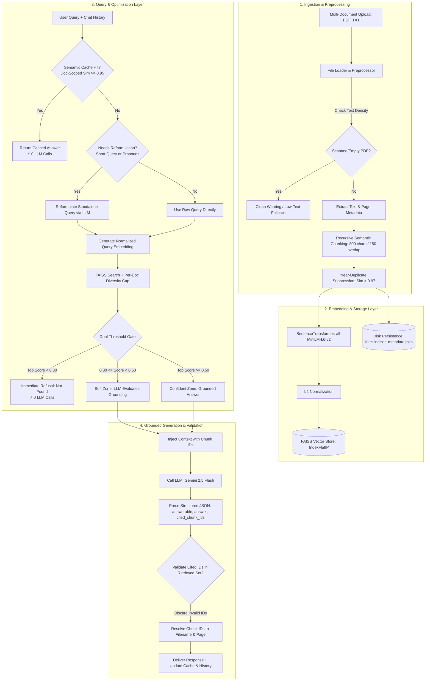

# 📚 Intelligent Grounded Document Q&A System (RAG)

An enterprise-ready, modular **Retrieval-Augmented Generation (RAG)** system built in Python for accurate, hallucination-resistant question answering over multi-document collections (PDF, TXT).

The system integrates **calibrated dual-threshold relevance gating**, **strict chunk-ID citation verification**, **conversational context memory**, **cross-document conflict detection**, and an **extensive 4-tier LLM call optimization architecture** designed to minimize API consumption while strictly preventing unsupported answers.

---

## 🚀 Key Features

- **📂 Heterogeneous Multi-Document Ingestion**:
  - Ingest multiple PDF and TXT documents simultaneously.
  - Page-level text extraction with character offsets, Unicode normalization, and corrupt/encrypted PDF handling.
  - Automatic detection of image-only / low-text scanned documents with graceful fallback alerts.
- **✂️ Recursive Semantic Chunking**:
  - 800-character chunks with 150-character overlap preserving topic continuity and sentence boundaries.
  - Structured metadata schema `{chunk_id, doc_id, filename, page, char_start, char_end}`.
- **⚡ Normalized Vector Database with FAISS**:
  - `sentence-transformers/all-MiniLM-L6-v2` dense embeddings.
  - Unit L2-normalization mapping FAISS `IndexFlatIP` to exact Cosine Similarity ($[-1, 1]$).
  - Near-duplicate chunk suppression ($S_c > 0.97$) and disk index persistence.
- **🎯 Calibrated Dual-Threshold Relevance Gating**:
  - **Hard Floor ($\tau_{floor} = 0.30$)**: Below 0.30, queries are rejected immediately with **0 LLM calls**.
  - **Soft Zone ($0.30 \le S_c < 0.50$)**: Marginal matches are passed to the LLM with strict instructions to abstain if unsupported.
  - **Confident Zone ($S_c \ge 0.50$)**: High-confidence semantic matches.
- **🛡️ Strict Grounding & Programmatic Citation Validation**:
  - Structured JSON response schema (`answerable`, `answer`, `cited_chunk_ids`, `conflict_detected`).
  - LLM cites programmatic chunk IDs (`[doc_01_p1_c01]`). Code validates citations against the retrieved set, stripping ungrounded citations.
  - Cross-document conflict detection with per-document diversity capping (`max_chunks_per_doc = 3`).
- **💬 Conversational Memory & Coreference Reformulation**:
  - Sliding-window chat buffer tracking multi-turn interactions.
  - Heuristic-driven reformulation: standalone queries bypass LLM rewriting, while short follow-ups and pronouns trigger contextual reformulation.
- **💰 4-Tier LLM Call & Cost Optimization**:
  - On-Demand summarization (saves 1 full-document LLM call per upload).
  - Document-scoped semantic query caching ($\ge 0.95$ cosine similarity returns answers in 0ms with **0 LLM calls**).
  - Early-exit relevance filtering (saves 100% of LLM calls on unanswerable/out-of-scope queries).

---

## 🧠 System Architecture



---

## 📁 Modular Project Structure

```
Content Summarizer/
│
├── app.py                     # Streamlit multi-document chat interface
├── evaluate.py                # Automated benchmark evaluation runner (10 queries)
├── implementation.md          # Architectural implementation plan & gap analysis
├── technical_decisions.md     # Deep dive into 3 core architectural decisions
├── evaluation_report.md       # Comprehensive benchmark evaluation report
├── requirements.txt           # Python dependencies
│
├── sample_docs/               # Benchmark test document collection
│   ├── doc_a_os_scheduling.txt       # CPU scheduling (RR quantum = 10ms)
│   ├── doc_b_os_realtime.txt         # Real-time systems (RR quantum = 20ms - conflicting)
│   ├── doc_c_process_memory.txt      # Deadlock 4 conditions, process states, Table 3.1
│   └── doc_d_unreadable_scan.pdf     # Scanned low-text PDF test asset
│
├── utils/
│   ├── content.py             # Multi-document loader, text cleaner, exception handler
│   └── chunks.py              # 800-char recursive chunker with metadata tracking
│
├── rag/
│   ├── embedder.py            # SentenceTransformer wrapper with L2 normalization
│   ├── vector.py              # FAISS IndexFlatIP store with persistence & deduplication
│   └── retriever.py           # Dual-threshold relevance gating & diversity cap
│
├── llm/
│   ├── model.py               # Gemini client with exponential backoff & JSON validation
│   ├── prompt.py              # Closed-domain grounded prompts & chunk-ID schema
│   ├── conversation.py        # Sliding-window memory & heuristic query condenser
│   └── cache.py               # Document-scoped semantic query cache
│
└── tests/
    └── test_rag.py            # Pytest test suite (9 unit tests)
```

---

## 🛠️ Setup & Installation

### 1. Clone & Activate Environment
```bash
git clone https://github.com/kartik23-2/Content-Summarizer.git
cd Content-Summarizer

# Activate virtual environment
venv\Scripts\activate   # Windows
# or source venv/bin/activate on Linux/macOS
```

### 2. Install Dependencies
```bash
pip install -r requirements.txt
```

### 3. Configure Environment Variables
Create or verify `.env` in the root directory:
```env
GEMINI_API_KEY=your_gemini_api_key_here
GEMINI_MODEL=gemini-2.5-flash
SIMILARITY_HARD_FLOOR=0.30
SIMILARITY_CONFIDENT_THRESHOLD=0.50
```

---

## 🧪 Testing & Evaluation

### Run Unit Tests
```bash
pytest tests/test_rag.py -v
```
Verifies text normalization, page loading, scan warnings, chunk metadata schemas, FAISS L2 normalization, duplicate suppression, persistence, threshold gating, and citation validation.

### Run Benchmark Evaluation Suite
```bash
python evaluate.py
```
Executes all 10 representative test queries against `sample_docs/`, logging similarity scores, gate decisions, LLM calls, retrieval hit rate, and faithfulness scores into `evaluation_results.json`.

---

## 🖥️ Running the Application

Launch the Streamlit interactive UI:
```bash
streamlit run app.py
```

### Interactive Usage Walkthrough:
1. **Upload Documents**: Drag and drop `sample_docs/doc_a_os_scheduling.txt`, `doc_b_os_realtime.txt`, and `doc_c_process_memory.txt` into the sidebar.
2. **Review Metrics**: Inspect indexed document counts, pages, and chunks in the sidebar.
3. **Optional Summary**: Click *"Generate Document Summary"* to create an on-demand summary (1 LLM call).
4. **Interactive Q&A**:
   - Ask: *"What is the definition of Deadlock in operating systems?"*
   - Ask follow-up: *"Can you explain the second condition in more detail?"* (Reformulates automatically).
   - Test Conflict: *"What is the recommended time quantum for Round Robin according to Doc A vs Doc B?"* (Highlights 10ms vs 20ms discrepancy).
   - Test Unanswerable: *"What is the formula for calculating quantum gravity in black holes?"* (Refuses with 0 LLM calls).
   - Test Cache: Repeat any question (Instant response with 0 LLM calls).
