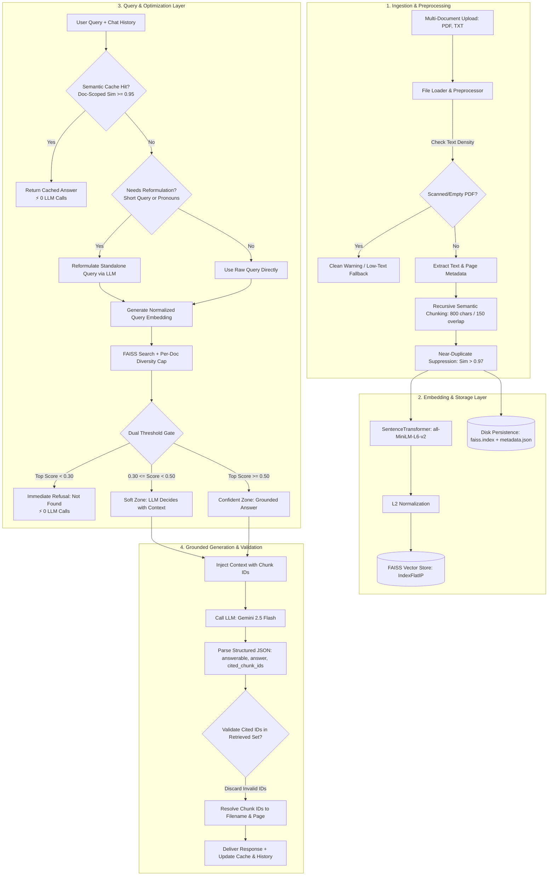

# Implementation Plan: Production-Grade Grounded Document Q&A System (RAG)

## 1. Executive Summary & Objective

### 1.1 Objective
The objective of this project is to develop an intelligent, production-grade **Retrieval-Augmented Generation (RAG)** question-answering system capable of ingesting heterogeneous multi-document collections (PDF, TXT), performing semantically accurate and resilient retrieval, and generating strictly grounded responses with source citations while eliminating unsupported hallucinations.

The system addresses critical challenges in modern RAG engineering:
- **Empirically Calibrated Dual-Threshold Relevance Gating**: Eliminates false abstentions on short queries while blocking out-of-scope queries without costly LLM calls.
- **Strict Chunk-ID Grounding & Source Validation**: LLMs cite programmatic chunk IDs (`[doc_01_p1_c01]`), which are verified in code against retrieved sets before rendering user-facing citations.
- **Conversational Memory & Robust Query Reformulation**: Context-aware follow-up resolution with anaphora heuristics.
- **Conflict & Duplicate Management**: Per-document retrieval diversity caps and near-duplicate vector suppression.
- **Multi-Tier LLM Call Optimization**: Drastically cuts LLM API overhead via on-demand summarization, document-scoped semantic caching, and deterministic early-exit gates.
- **End-to-End Evaluation Harness**: 10 representative test queries, ground-truth hit tracking, and automated metric logging.

---

## 2. Current State Assessment & Gap Analysis

| Feature / Requirement | Current Implementation (`app.py`, `rag/`, `llm/`, `utils/`) | Target Implementation (Post-Review Plan) | Priority / Status |
| :--- | :--- | :--- | :--- |
| **Document Upload** | Single file upload (`accept_multiple_files=False`). | Multi-document upload (`PDF`, `TXT`) with batch processing and format validation. | **High** |
| **Source Citations** | Chunks stored as raw strings; metadata is discarded. | Structured chunk metadata schema `{chunk_id, doc_id, filename, page, char_range}` with programmatic validation. | **Critical** |
| **Hallucination Guardrails** | `qa_prompt` explicitly instructs LLM: *"If context does NOT contain relevant info: Answer using own knowledge"*. | Strict closed-domain prompt; structured JSON response with `answerable: bool` and citation verification. | **Critical** |
| **Relevance Filtering** | Blind top-$k$ retrieval via unnormalized $L_2$ distance; no threshold. | Normalized inner product (`IndexFlatIP`) with calibrated dual threshold (hard floor $\tau_{floor} = 0.30$, confident $\tau_{conf} = 0.50$). | **Critical** |
| **Conversational Context** | Stateless query input; follow-ups fail due to lack of chat history. | Sliding-window chat buffer + heuristic-driven query reformulation for pronouns/short follow-ups. | **High** |
| **LLM Call Optimization** | Full document text unconditionally sent for summary on every upload; no caching. | On-demand summarization, document-scoped semantic caching, and early-exit relevance gating. | **High** |
| **Index Persistence** | In-memory only; re-computed on every reload. | Disk persistence (`faiss.write_index`, `metadata.json`) with collection hash validation. | **Medium** |
| **Conflict Handling** | Highest scoring chunks dominate, allowing one document to crowd out conflicting sources. | Per-document diversity cap (max 2 chunks per doc) to ensure conflicting perspectives land in top-$k$. | **Medium** |
| **Exception Handling** | Minimal; crashing on encrypted PDFs or rate limits. | Graceful error handling for corrupt/empty PDFs, image-only scans, API rate limits, and empty index. | **High** |
| **Evaluation Suite** | None. | Automated test harness with 10 representative queries, ground-truth labels, and metric reporting. | **High** |

---

## 3. Target System Architecture



---

## 4. Component Implementation Specifications

### 4.1 Ingestion & Preprocessing (`utils/content.py`)
- **Multi-Document Support**: Supports batch loading of PDFs and TXTs via Streamlit and script interfaces.
- **Robust Exception Handling**:
  - Encrypted / password-protected PDFs: Catch `PdfReadError` and notify user gracefully.
  - Corrupt / 0-byte files: Discard with an informative error message.
  - Low-text / Scanned PDFs: If extracted character count per page is $< 50$, issue a clear warning (`"Document appears to be scanned or image-based with low text density"`) rather than indexing empty noise.
- **Text Cleaning**: Normalize Unicode (NFKD), strip carriage returns (`\r`), collapse redundant whitespace, and preserve paragraph breaks.

### 4.2 Semantic Chunking Engine (`utils/chunks.py`)
- **Configuration**:
  - Target Chunk Size: `800` characters (~160–200 words / ~150 tokens).
  - Chunk Overlap: `150` characters (~30 words).
  - Separators: `["\n\n", "\n", ". ", " ", ""]`.
- **Justification**:
  - 500 characters is frequently too small for complex technical and academic paragraphs, fragmenting topic sentences.
  - 800 characters maintains cohesive context for definitions, algorithms, and multi-sentence facts while comfortably fitting within the 256/512 token context limit of `all-MiniLM-L6-v2`.
- **Chunk Metadata Schema**:
  ```python
  {
      "chunk_id": "doc_01_p2_c03",
      "doc_id": "doc_01",
      "filename": "os_concepts.pdf",
      "page": 2,
      "char_start": 850,
      "char_end": 1650,
      "content": "Mutual exclusion: At least one resource must be held in a non-shareable mode..."
  }
  ```

### 4.3 Normalized Vector Database (`rag/vector.py` & `rag/embedder.py`)
- **Model**: `sentence-transformers/all-MiniLM-L6-v2` (384 dimensions).
- **Metric**: Inner product (`IndexFlatIP`) after `faiss.normalize_L2(vectors)`. This maps all distances to exact Cosine Similarity in $[-1, 1]$.
- **Near-Duplicate Suppression**:
  - Before adding new chunks to the index, compare candidate chunk embeddings against existing vectors.
  - If cosine similarity $> 0.97$, flag the chunk as a duplicate to conserve index space and prevent retrieval redundancy.
- **Index Persistence**:
  - `save(directory_path)`: Writes `faiss.index` via `faiss.write_index` and `metadata.json`.
  - `load(directory_path)`: Restores `faiss.read_index` and metadata mappings.

### 4.4 Calibrated Dual-Threshold Retrieval & Diversity Cap (`rag/retriever.py`)
- **Addressing the MiniLM Score Distribution**:
  - Short queries (e.g. 3–5 words) against 800-character chunks naturally yield lower dot products (typically 0.35–0.55 for true matches). A rigid 0.65 threshold causes severe false abstentions.
  - **Dual-Threshold Architecture**:
    1. **Hard Floor ($\tau_{floor} = 0.30$)**: Below 0.30, queries are statistically noise/unrelated. The system immediately outputs the refusal string with **0 LLM calls**.
    2. **Soft Zone ($0.30 \le S_{top} < 0.50$)**: Marginal matches. Context is passed to the LLM with instructions to abstain (`"answerable": false`) if the content is not directly supportive.
    3. **Confident Zone ($S_{top} \ge 0.50$)**: High-confidence match.
- **Per-Document Diversity Cap (Conflict Handling)**:
  - When searching multi-document collections, the retriever caps chunks from any single document at `max_chunks_per_doc = 2` within top-$k$ ($k=4$).
  - Prevents a verbose document from monopolizing the context window, ensuring conflicting sources (e.g., Doc A vs. Doc B) are both retrieved.

### 4.5 Structured Grounding & Programmatic Citation Verification (`llm/prompt.py` & `llm/model.py`)
- **Chunk-ID Attribution**: Chunks are presented to the LLM with unambiguous identifiers:
  ```text
  Context Chunk [doc_01_p1_c01] (Source: os_notes.pdf, Page 1):
  ...
  Context Chunk [doc_02_p3_c04] (Source: realtime_os.pdf, Page 3):
  ...
  ```
- **Structured JSON Schema**:
  The LLM must respond strictly with JSON:
  ```json
  {
      "answerable": true,
      "answer": "Deadlock requires four simultaneous conditions: Mutual Exclusion, Hold and Wait, No Preemption, and Circular Wait [doc_01_p1_c01].",
      "cited_chunk_ids": ["doc_01_p1_c01"],
      "conflict_detected": false,
      "conflict_explanation": ""
  }
  ```
- **Programmatic Citation Validation**:
  - Code inspects `cited_chunk_ids`. Any ID not present in the retrieved chunk set is rejected.
  - Code maps verified chunk IDs to user-friendly source labels: `[Doc: os_notes.pdf, Page 1]`.
- **Unified Refusal Response**:
  Standardized across all layers:
  `"The provided documents do not contain sufficient information to answer this question."`

### 4.6 Conversational Context & Query Reformulation (`llm/conversation.py`)
- **Heuristic-Driven Reformulation**:
  - An LLM call is only spent on query reformulation if:
    1. Chat history is non-empty, **AND**
    2. Query is short ($\le 6$ words, e.g. *"Why is that?"*, *"What about Doc B?"*, *"And the third one?"*), **OR**
    3. Query contains conversational pronouns or ordinals: `["it", "this", "that", "they", "these", "the former", "the latter", "first", "second", "third", "previous", "above"]`.
  - Self-contained queries (e.g. *"What is round-robin scheduling in operating systems?"*) bypass reformulation, saving 1 LLM call.

### 4.7 Document-Scoped Semantic Query Cache (`llm/cache.py`)
- **Cache Keying**:
  - In-memory store: `{(doc_collection_hash, query_vector): {response, citations}}`.
  - The cache key uses the **reformulated query** (never the raw follow-up) to prevent semantic collisions like *"explain it more"* matching across topics.
- **Scope & Invalidation**:
  - Scoped to the MD5 hash of all active uploaded document names and sizes.
  - Automatically invalidated whenever documents are added or removed.
- **Known Limitation**:
  - Very subtle semantic inversions (negations like *"X is allowed"* vs. *"X is not allowed"*) can produce high cosine similarity (>0.94). An exact string match check and low temperature reduce this risk.

---

## 5. Evaluation Framework & Benchmark Suite

### 5.1 Ten Representative Test Queries

The system is evaluated using a test suite spanning 4 custom-crafted documents (`sample_docs/`):
- `doc_a_os_scheduling.txt` (Standard OS scheduling, Round Robin Quantum = 10ms)
- `doc_b_os_realtime.txt` (Real-Time OS scheduling, Round Robin Quantum = 20ms — conflicting with Doc A)
- `doc_c_process_memory.txt` (Process states, 4 deadlock conditions, and Table 3.1 with execution times)
- `doc_d_unreadable_scan.pdf` (Minimal text-sparse scanned document to test graceful warnings)

| # | Query | Category | Expected Behavior | Target Chunks / Source | Pass Metric |
| :--- | :--- | :--- | :--- | :--- | :--- |
| **Q1** | *"What is the definition of Deadlock in operating systems?"* | Direct Factual Lookup | Retrieves deadlock chunk; returns grounded definition with citation. | `doc_c_process_memory.txt` (Page 1) | Hit Rate = 1, Faithfulness = 1 |
| **Q2** | *"Compare preemptive and non-preemptive scheduling."* | Multi-Chunk Synthesis | Synthesizes differences from scheduling chunks with multiple citations. | `doc_a_os_scheduling.txt` (Page 1) | Hit Rate = 1, Faithfulness = 1 |
| **Q3** | *"What are the 4 necessary conditions for deadlock?"* | Comprehensive Extraction | Lists Mutual Exclusion, Hold & Wait, No Preemption, Circular Wait. | `doc_c_process_memory.txt` (Page 1) | Hit Rate = 1, Faithfulness = 1 |
| **Q4** | *"What is the recommended time quantum for Round Robin scheduling according to Doc A vs Doc B?"* | Cross-Document Conflict | Retrieves from both docs; reports Doc A (10ms) vs Doc B (20ms) conflict. | `doc_a` (Page 1) & `doc_b` (Page 1) | Both docs cited; conflict noted |
| **Q5** | *"Explain the 5 basic states of a process."* | High-Level Conceptual | Explains New, Ready, Running, Waiting, Terminated accurately. | `doc_c_process_memory.txt` (Page 2) | Hit Rate = 1, Faithfulness = 1 |
| **Q6** | *"What is the formula for calculating quantum gravity in black holes?"* | Out-of-Scope (Unanswerable) | Top score $< \tau_{floor}$ (0.30); system immediately refuses without calling LLM. | None (Refusal expected) | 0 LLM calls, Refusal returned |
| **Q7** | *"What does the document say about atmospheric conditions on Mars?"* | Adversarial / Negative | Refuses to answer; asserts no information exists in uploaded documents. | None (Refusal expected) | `answerable: false`, No hallucination |
| **Q8** | *"Can you explain the second condition in more detail?"* (Following Q3) | Conversational Follow-Up | Reformulates to "Hold and Wait deadlock condition"; explains accurately. | `doc_c_process_memory.txt` (Page 1) | Correct anaphora resolution |
| **Q9** | *"What are the exact execution times listed in Table 3.1?"* | Tabular / Numerical Extraction | Extracts Task A (12ms), Task B (8ms), Task C (15ms) accurately. | `doc_c_process_memory.txt` (Page 2) | Exact numerical match |
| **Q10**| *"What is the main topic covered in the scanned document?"* | Low-Text / Scanned PDF | Detects low text density; returns clean warning about image-based scan. | `doc_d_unreadable_scan.pdf` | Clean scan warning triggered |

### 5.2 Evaluation Metrics
1. **Retrieval Hit Rate**: Percentage of queries where at least one ground-truth source chunk appears in top-$k$ retrieved chunks.
2. **Retrieval Recall@4**: Fraction of all relevant ground-truth chunks retrieved in top-4.
3. **Generation Faithfulness (0/1)**: Binary verification that every claim in the generated response is directly substantiated by cited chunks.
4. **Abstention Precision**: Accuracy of refusing unanswerable queries (Q6, Q7) without false positives.
5. **Efficiency & Cost**: Log of total LLM API calls spent across the 10 benchmark queries.

---

## 6. Technical Decisions Summary

1. **Chunking Strategy**: 800-character recursive splitting with 150-character overlap balances semantic coherence and boundary safety without diluting vector representations.
2. **Calibrated Dual Threshold with Normalized Cosine Similarity**: Employs FAISS `IndexFlatIP` with L2-normalized vectors. Distinguishes hard out-of-domain queries ($<0.30$) from borderline and high-confidence matches.
3. **Multi-Tiered Call Optimization**: Replaces eager summarization with on-demand execution, uses document-scoped semantic caching, and filters unanswerable queries before the LLM step.
4. **Programmatic Chunk-ID Citation Validation**: Replaces regex-based formatting checks with programmatic ID verification against the retrieved set.
